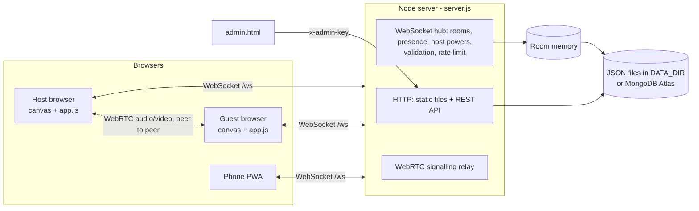
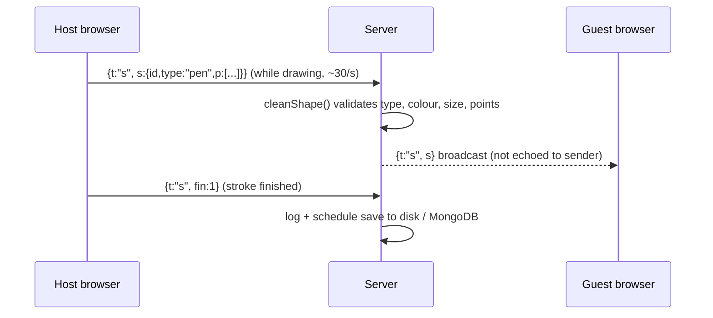

# SketchSync architecture

## Message flow for one stroke

## Messages (client to server)

| `t` | Who may send | Purpose |
|---|---|---|
| `s`, `batch`, `mvimg`, `del` | editors | draw, add templates, move image, delete |
| `clr` | host (or the only person) | clear board |
| `board` | editors | board colour, pattern, spacing (synced to all) |
| `kick`, `host`, `role`, `roomlock` | host only | remove, make host, view-only/allow draw, lock room |
| `present`, `view` | anyone / presenter only | follow-the-presenter |
| `call`, `sig` | anyone | voice/video call flags and WebRTC offer/answer/ICE relay |
| `chat`, `cur`, `react`, `lock`, `pgs`, `load`, `ping`, `resync`, `getlog` | as before | chat, cursors, reactions, lock board, pages, load session |

## Security measures
- Room passwords are hashed with scrypt (never stored in plain text). Wrong-password attempts are rate-limited per IP.
- Room codes made by "New private room" have about 40 bits of randomness (8 characters from a 31-character alphabet).
- Only the host can kick, make host, mute, lock the room, or clear the board for others.
- Every shape is validated on the server: type, colour, number ranges, point counts, image type and size.
- Origin check on WebSocket upgrade (blocks other websites from joining rooms from a visitor's browser).
- Per-user message rate limit, body size limit, CSP and other security headers, masked IPs in the admin console.
